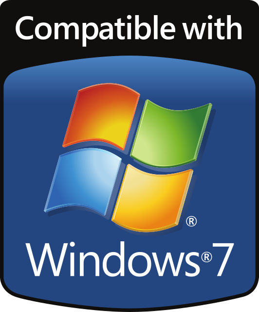
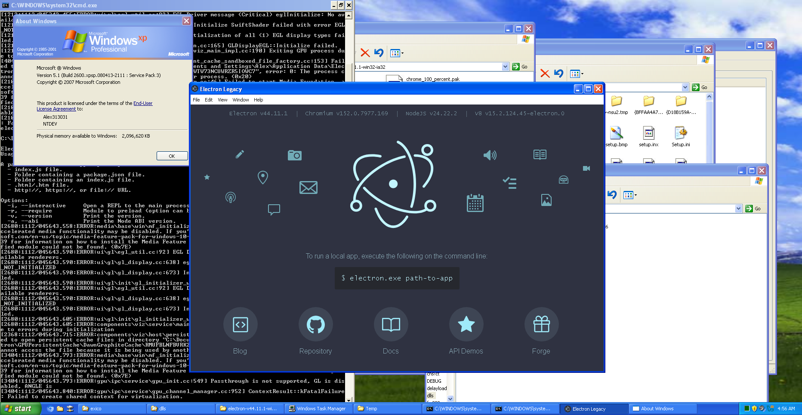

#  Electron for Legacy Windows 

This is a set of build scripts and patches to produce builds of up-to-date [Electron](https://electronjs.org/) supporting legacy
versions of Windows (XP/Vista/7/8/8.1), with additional enhancements listed below.

*Electron 44.11.1 — Chromium 152, Node 24.22.2 — on Windows XP SP3.
See [Windows Vista and XP](./docs/BUILDING.md#windows-vista-and-xp).*

## Synopsis

Existing Electron forks for Windows 7 were incomplete and hard to use, in addition I wanted:

 - Cross-compiling support: upstream Electron doesn't support cross building for Windows from Linux, unlike Chromium. Some small patching allows this.
 - 32 bit support: Electron 43.x [was the last](https://github.com/electron/electron/pull/51816) version with 32 bit support. I restored it.
 - The [pre-Chrome Refresh 2023 UI](https://github.com/Alex313031/thorium/blob/main/docs/TH24.md#screenshots) back (which affects Electron's UI too): the current menu UI is ugly for native apps that Electron apps are supposed to be.
 - Compiler optimizations: the optimization and SIMD flags from [Thorium](https://github.com/Alex313031/thorium), ported in `patches/other/02-optimization-and-SIMD-args.patch`.
 - More codecs: [HEVC](https://en.wikipedia.org/wiki/High_Efficiency_Video_Coding), [AC-3 and E-AC-3](https://en.wikipedia.org/wiki/Dolby_Digital#Dolby_AC-3), and MPEG-2 video, software decoded instead of left to the platform. See [Codecs](./docs/CODECS.md).
 - Windows XP/Vista support: working as of 44.11.1 — believed to be the first Electron to run on XP since the pre-1.0 releases built on Chromium M49. Build it with `--xp` and launch with `--no-sandbox --disable-gpu` for now; see [Building](./docs/BUILDING.md#windows-vista-and-xp).

## Download
Release artifacts are served at [Releases](https://github.com/Alex313031/electron-legacy/releases).

To add or use in an existing project, see [USAGE.md](./docs/USAGE.md).

## Building

See [BUILDING.md](./docs/BUILDING.md).

## About
For an overview how Electron works, see [ELECTRON_DESIGN.md](./docs/ELECTRON_DESIGN.md).

Legacy Windows support is based on patches from [Electron-for-windows-7](https://github.com/e3kskoy7wqk/Electron-for-windows-7). It is worth noting that
the first person to get Electron back working on Win7 was the [Supermium](https://github.com/win32ss/supermium) (Chromium fork that supports XP+) author's
[fork of Electron](https://github.com/win32ss/supermium-electron).  
Some NodeJS patches for making Node + Installer standalone came from my [nodejs-win7 repo](https://github.com/Alex313031/nodejs-win7).  
HEVC/AC3 software decoding support was added from code from Thorium, however the original sources for these patches come from 
[ThaUnknown's Electron](https://github.com/ThaUnknown/electron-chromium-codecs) and [StaZhu's Chromium/Electron HEVC patches](https://github.com/StaZhu/enable-chromium-hevc-hardware-decoding).

## License

The patches and code in this repo are licensed under the [BSD-3 License](./LICENSE.md).

Electron itself uses the [MIT License](https://github.com/electron/electron/blob/main/LICENSE) and other libraries with their own respective licenses.
